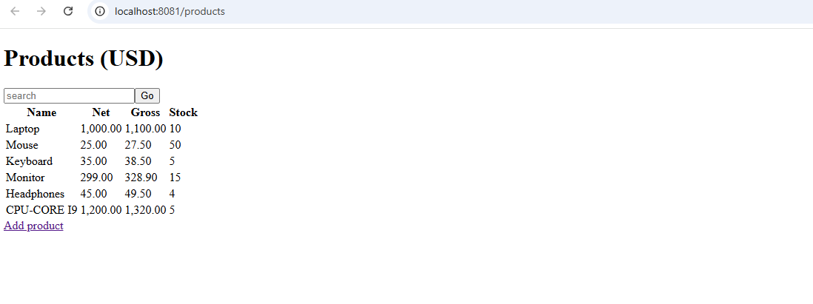
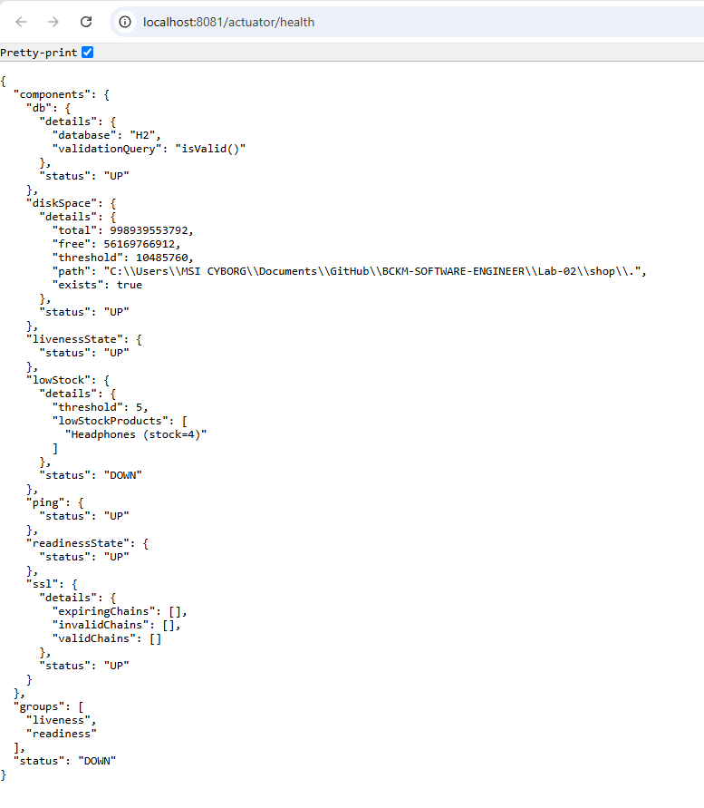

# Lab-02 – Spring Boot Shop

## Requirements
- Java 25
- Docker Desktop (only for the MySQL option)

All commands are run from the `Lab-02/shop` folder:

```powershell
cd Lab-02\shop
```

## 1. Run the tests

```powershell
.\mvnw test
```
Tests use their own in-memory H2 database (`src/test/resources/application.yml`).

## 2. Run the app

 `.\mvnw spring-boot:run` Quick start.
 `.\mvnw spring-boot:run "-Dspring-boot.run.profiles=dev"` for **dev** | Development: H2 console on, DEBUG logs |
 `.\mvnw spring-boot:run "-Dspring-boot.run.profiles=prod"` for **prod** | Server mode: H2 console off, INFO logs, DB from env variables |

The app runs on **http://localhost:8081**. Stop it with `Ctrl+C`.

## 3. Open the app


| Hello endpoint | http://localhost:8081/hello?name=Ann | 1 |
| REST API (JSON, Postman) | http://localhost:8081/api/products | 4 |
| Web UI – product list | http://localhost:8081/products | 5 |
| Web UI – new product form | http://localhost:8081/products/new | 5 |
| Health check | http://localhost:8081/actuator/health | 5 |
| App info | http://localhost:8081/actuator/info | 5 |
| H2 console (dev only) | http://localhost:8081/h2-console | 3 |

## 4. H2 console login

| Field | Value |
|---|---|
| JDBC URL | `jdbc:h2:file:./data/shop` |
| User Name | `shop` |
| Password |  |

The database is stored in `data/shop.mv.db` (ignored by Git, so each person has their own).

### Screenshots

**JSP product list** 



**Health check DOWN** (`/actuator/health`).



